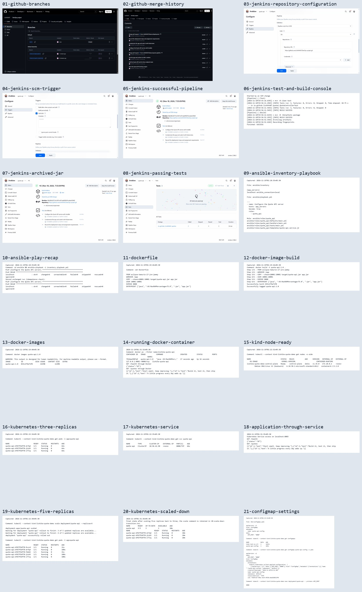

# Evidence index

Lishika Meghani | 1MS24CI065

All evidence was captured from this project on 19 November 2026. GitHub and Jenkins UI captures are used for items 01–05, 07 and 08. Item 07 uses the same genuine build page as item 05 because it shows the archived JAR. Items 06 and 09–21 are renderings of actual recorded outputs; their complete source logs are retained in `logs/`.

- [01-github-branches](01-github-branches.jpg)
- [02-github-merge-history](02-github-merge-history.jpg)
- [03-jenkins-repository-configuration](03-jenkins-repository-configuration.jpg)
- [04-jenkins-scm-trigger](04-jenkins-scm-trigger.jpg)
- [05-jenkins-successful-pipeline](05-jenkins-successful-pipeline.jpg)
- [06-jenkins-test-and-build-console](06-jenkins-test-and-build-console.jpg)
- [07-jenkins-archived-jar](07-jenkins-archived-jar.jpg)
- [08-jenkins-passing-tests](08-jenkins-passing-tests.jpg)
- [09-ansible-inventory-playbook](09-ansible-inventory-playbook.jpg)
- [10-ansible-play-recap](10-ansible-play-recap.jpg)
- [11-dockerfile](11-dockerfile.jpg)
- [12-docker-image-build](12-docker-image-build.jpg)
- [13-docker-images](13-docker-images.jpg)
- [14-running-docker-container](14-running-docker-container.jpg)
- [15-kind-node-ready](15-kind-node-ready.jpg)
- [16-kubernetes-three-replicas](16-kubernetes-three-replicas.jpg)
- [17-kubernetes-service](17-kubernetes-service.jpg)
- [18-application-through-service](18-application-through-service.jpg)
- [19-kubernetes-five-replicas](19-kubernetes-five-replicas.jpg)
- [20-kubernetes-scaled-down](20-kubernetes-scaled-down.jpg)
- [21-configmap-settings](21-configmap-settings.jpg)

Figure title, student-name, date and source banners are omitted from the images. The command-output figures are renderings of the stored logs; provenance is recorded in this index.
